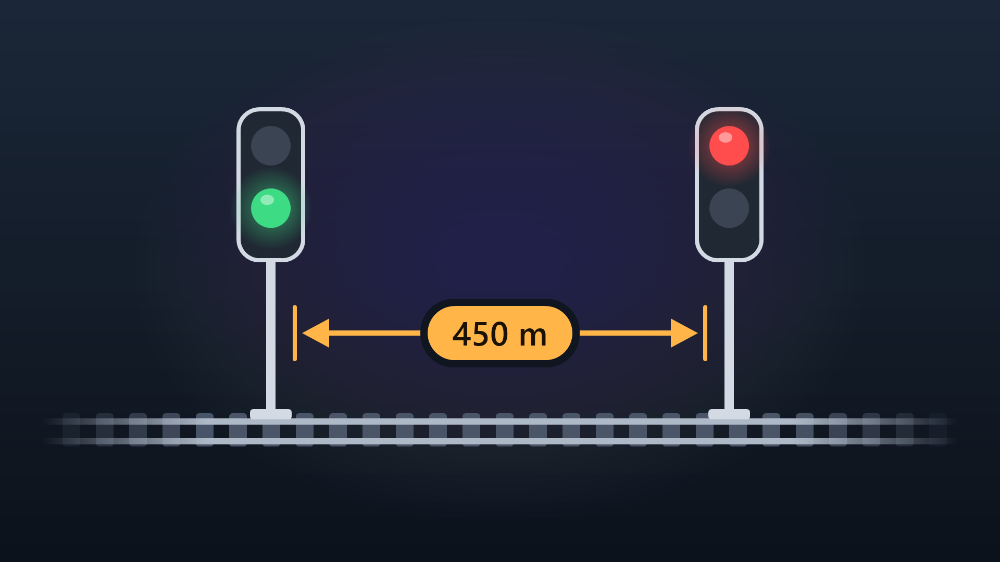

# Signal Block Length Tooltips

A quality-of-life mod for **Transport Fever 3** that shows the length of a railway signal block right in the tooltip.

## Features

- **While placing a signal**, the tooltip shows the distance back to the previous signal facing the same direction, or to the end of the track.
- **When hovering over an existing signal**, its block length is shown below the signal name.
- **Switches** are followed in every direction a train could come from. If the routes differ in length, the tooltip shows the shortest and longest as a range (e.g. `320 m – 540 m`).
- **Crossings** without a switch are passed straight through only.
- **Distances** follow your game settings (metric or imperial, local decimal separator).
- **Fast on large maps:** track data and results are cached, so dragging a signal stays smooth.
- **Localized** into all 13 languages supported by Transport Fever 3.

## Installation

Install the mod from the in-game mod browser, or copy this repository's contents into a folder named `signal_block_length` in your Transport Fever 3 mods directory. Then enable it in the mod settings.

The mod only adds tooltip information and does not change your savegame, so it can be added to or removed from existing games at any time.

## Project structure

| Path | Purpose |
|---|---|
| `content/gui/signal_block_length/block_length.lua` | Walks the track graph and computes the block length |
| `content/gui/signal_block_length/hook.script.lua` | Hooks the signal tool and the hover tooltip |
| `content/gui/signal_block_length/hook.res.lua` | Registers the GUI hook with the game |
| `strings.json` | Tooltip translations |
| `_metadata/` | Mod browser name, descriptions and preview image |

To troubleshoot, set `DEBUG = true` at the top of `block_length.lua`; diagnostic output then appears in the game log.

## AI disclosure

This mod's source code was developed with the assistance of AI tools. Should you encounter a defect or see an opportunity for improvement, please report it through an issue or propose a fix through a pull request.

## Contributing

Contributions are welcome! Bug reports, improvements, better translations and new ideas are all appreciated. Feel free to open an issue or submit a pull request.

## License

This project is licensed under the [MIT License](LICENSE).
